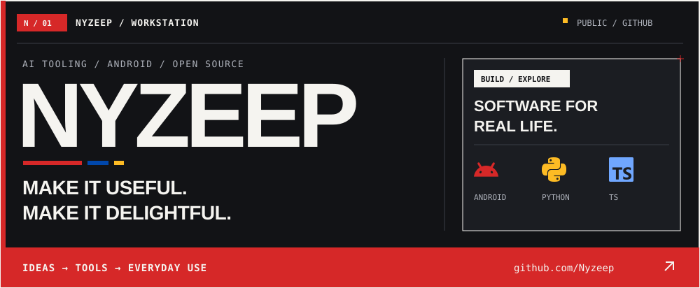
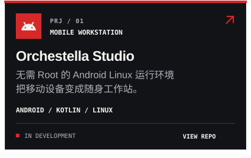
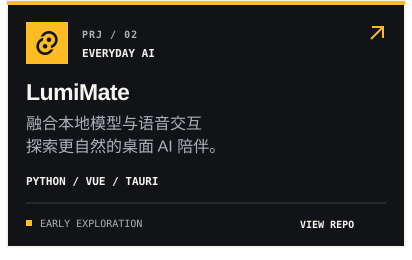
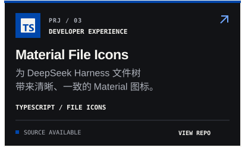
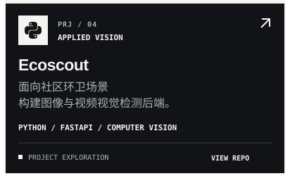
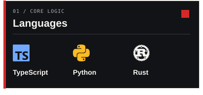
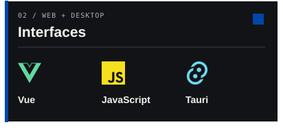
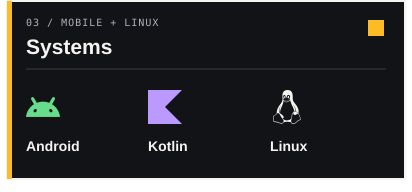
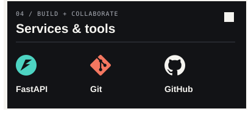

<picture>
  <source media="(max-width: 600px)" srcset="./assets/profile/hero-mobile.svg" />
  
</picture>

<h1 align="center">你好，我是 Nyzeep。</h1>

  把想法做成用得上的工具，也认真打磨每一个日常细节。 
  最近在探索 <b>Android 上的 Linux</b>、<b>桌面 AI 伙伴</b>与<b>开发者体验</b>。

  
  
  

  <a href="#selected-work">精选项目</a> · <a href="#tech-stack">技术栈</a> · <a href="#activity">开发动态</a>

<h2 id="selected-work">01 / Selected work</h2>

从移动工作站到桌面 AI，再到更顺手的开发界面。这里是我正在持续打磨的一些公开项目。

  
  
  
  

  <a href="https://github.com/Nyzeep/Orchestella-Studio">Orchestella Studio</a> ·
  <a href="https://github.com/Nyzeep/LumiMate">LumiMate</a> ·
  <a href="https://github.com/Nyzeep/dsh-material-file-icons">Material File Icons</a> ·
  <a href="https://github.com/Nyzeep/Ecoscout">Ecoscout</a>

<blockquote>
  
图标扩展当前提供源码；项目进度、功能与安装方式请查看各仓库说明。

</blockquote>

<h2 id="tech-stack">02 / Tech stack</h2>

在公开项目中使用的语言、框架与工具。从界面到服务，从桌面到移动端。

  
  
  
  

Rust 用于 LumiMate 的 Tauri 桌面壳；更多技术实践见项目源码。

<h2 id="activity">03 / Build log</h2>

沿着代码的更新，看看想法如何一点点变成现实。

  
  

<ul>
  <li><a href="https://github.com/Nyzeep?tab=repositories">浏览全部公开仓库</a> — 项目、实验，以及还在生长的想法。</li>
  <li><a href="https://github.com/Nyzeep/Orchestella-Studio/releases">Orchestella Studio 发布记录</a> — 查看已发布版本与更新说明。</li>
  <li><a href="https://github.com/Nyzeep/Nyzeep/issues">留个想法</a> — 欢迎交流开发工具、移动 Linux 与 AI 交互。</li>
</ul>

 

<a href="https://github.com/Nyzeep">
  <picture>
    <source media="(max-width: 600px)" srcset="./assets/profile/footer-mobile.svg" />
    
  </picture>
</a>
